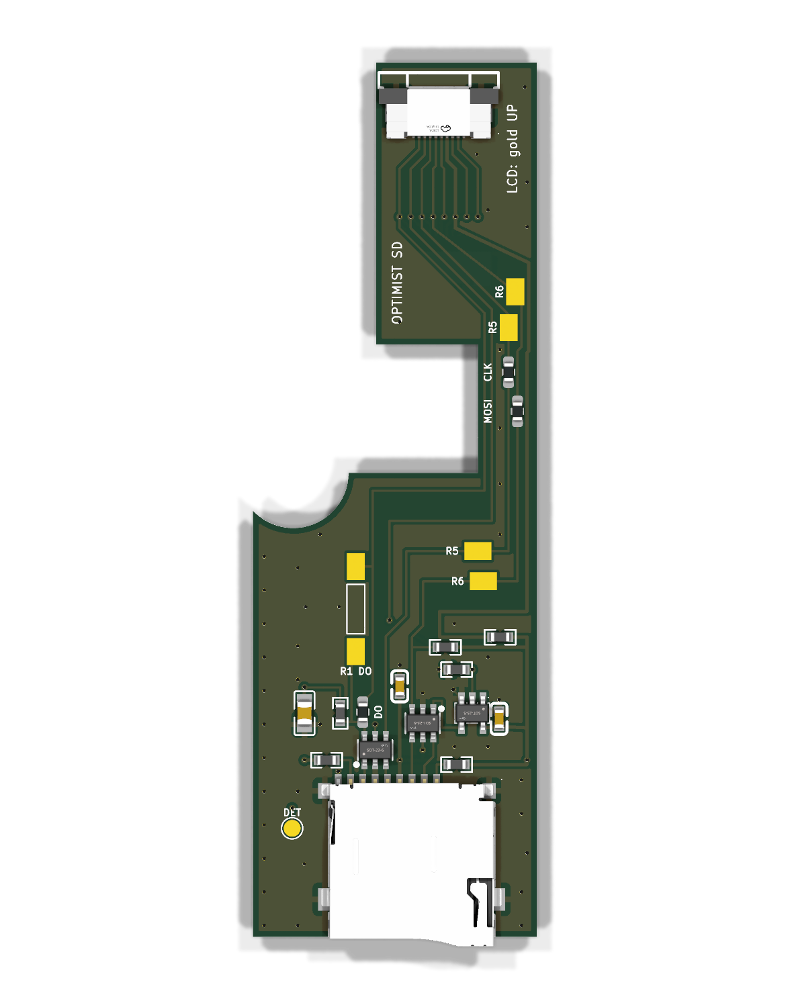

# The FM-1 SD board

A small add-on board that gives the **M-VAVE FM-1** a microSD card slot. **No soldering to the FM-1 is needed.** It sits
on the back of the FM-1's board right of the battery, with the card slot in the case's bottom wall, and plugs in between
the FM-1's LCD and its main board, so the card shares the LCD's SPI bus.

> **Not final yet.** The current board, `long-both-sides/`, has not been built. Its resistor values (R1, R5, R6) are not
> settled: they may change after the bench tests in [`BENCH-SHEET.md`](BENCH-SHEET.md). Only v6, the board it comes from
> (`archive-v6-tested/`), has been built and run in an FM-1.

## The boards

| Folder | What it is | Built? |
|---|---|---|
| [`long-both-sides/`](long-both-sides/) | **The current board.** 25.4 x 78.2 mm, one cable socket on each side (J3 for the LCD on the top, J2 for the cable from the FM-1 on the bottom), assembled on both sides. Pads beside R1, R5 and R6 take a leaded resistor soldered flat, to trim a value without touching the small parts. | No |
| [`archive-v6-tested/`](archive-v6-tested/) | v6, the only built board: both sockets on the top, plus swap jumpers and test pads for probing. Kept as the reference. | **Yes, ran a card in an FM-1 (2026-11-04)** |

Also here: [`NEXT-BOARD.md`](NEXT-BOARD.md), the speed review behind the resistor values; [`BENCH-SHEET.md`](BENCH-SHEET.md),
the tests on the bench; [`fm1/`](fm1/), the FM-1's measurements and J12's pins; [`tray/`](tray/), the printed tray;
[`lib/`](lib/), the footprints, 3D models and `stitch.py` shared by all boards; [`analysis/`](analysis/), the impedance
and delay scripts.

**Speed.** The card runs at 10 to 12 MHz on v6. The FM-1's own chip stops at about 15 MHz whatever the board does
(measured with a loopback, no card). The resistor values trade card speed against the screen: below about 300 ohm on
R5/R6 the screen can go black with its clock at 60 MHz. `long-both-sides` ships 330 / 330 / 150, the highest set
proven clean at 60 MHz, and its trim pads can only lower them.

## Order a board

You don't have to install KiCad or run anything. Everything is in the board's `fab/` folder.

### 1. Upload the zip to JLCPCB

Go to [JLCPCB](https://jlcpcb.com) > Order now and upload `long-both-sides/fab/sd-board-gerbers.zip`. The size is read
from the files and the design rules are standard (0.2 mm tracks and spacing, 0.3 mm holes), so the defaults work:

| Setting | Choice |
|---|---|
| Layers | 2 |
| PCB thickness | 1.6 mm |
| Surface finish | HASL |
| PCB Assembly | on, **Both sides** |
| Assembly type | Standard |
| BOM file | `fab/bom.csv` |
| CPL (placement) file | `fab/cpl.csv` |

Every part is a JLC part, so you buy nothing else for the board. J1, J2 and J3 are "extended" parts at JLC, a small fee
per part type. In the placement preview check that the card socket's opening is past the bottom edge and that both
cable sockets' openings face the top edge; J2 is on the bottom. A quote on 2026-11-09 for 10 boards assembled on both
sides was about 103 USD before shipping and VAT.

### 2. Buy the cable

A **10-pin, 0.5 mm pitch FFC cable, type A** (contacts on the same side at both ends), about 80 mm, from the FM-1's J12
to the board's J2, for example <https://www.aliexpress.com/item/4000022050815.html>. Use the shortest one that reaches.
The silkscreen by each socket says which way the contacts go: a cable turned over does not connect. You also need a
microSD card.

### 3. Fit it

1. Check the fit first with the 1:1 paper template `long-both-sides/template-1to1.pdf` (print at 100 %) or the printable
   mockup `long-both-sides/mockup-printable.stl`, and print the tray, [`tray/sd-tray.stl`](tray/sd-tray.stl).
2. Cut a slot about 15 x 2.5 mm in the case's bottom wall for the card, its left side 81.7 mm from the left wall's
   inside. The latched card ends about 0.5 mm inside the wall's outside face; push it in to release it.
3. Open the FM-1 and disconnect the battery. Slide the board into the tray, right of the battery.
4. Unplug the LCD's cable from J12 and plug it into the board's **J3** (gold up).
5. Connect the FM-1's J12 to the board's **J2** with the cable (gold down).

The card also needs firmware that knows about it: Optimist's SD card mode, or the SD stage of
[m-bootloader](https://github.com/jvitkauskas/m-bootloader).

## Changing the design

Each board is generated from Python (`make_board.py`, `make_schematic.py`) and checked and written out by one command in
the board's folder: `sh make_fab.sh` (KiCad 10). It runs the design-rule check, the schematic's electrical rule check and
`check_nets.py` (the schematic and the board have the same nets pin for pin), then writes `fab/`. The design notes are
in each board's `DESIGN.md`.

## Credit and licence

Taken from **m-card by Julius Vitkauskas, https://github.com/jvitkauskas/m-card, ec63784, CC0-1.0**: the shape of the
order readme, the 47 kOhm pull-up on the card's CMD line (his R8), and the idea and parameters of his `stitch()` for the
ground vias (`lib/stitch.py` is our own code for them). No file of his is copied. See [`../LICENSING.md`](../LICENSING.md).
