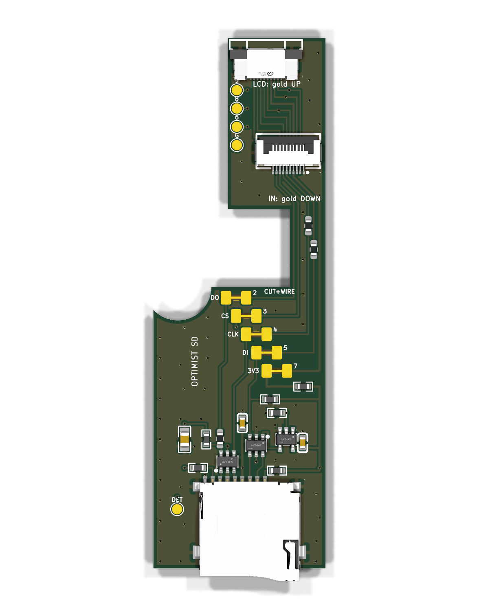

# The FM-1 SD board

A small add-on board (25.4 x 78.2 mm) that gives the **M-VAVE FM-1** a microSD card slot. **No soldering to the FM-1 is
needed.** It sits on the back of the FM-1's board right of the battery, with the card slot in the case's bottom wall. It
plugs in between the FM-1's LCD and its main board, so the card shares the LCD's SPI bus.

## The boards

There are three variants, and the tested v6 they come from. The two long boards have the same circuit and outline as v6 and use
the same tray (`tray/sd-tray.stl`); they differ in where J2 sits, the socket for the cable from J12.

| Folder | What it is | Zip to upload | Built? |
|---|---|---|---|
| [`long-same-side/`](long-same-side/) | Long board, both sockets on the top, J2 the same part as J3 and in line with it, cable arrives gold up; card socket 1 mm further in than v6 | `long-same-side/fab/sd-board-gerbers.zip` | No, never built or tested |
| [`long-both-sides/`](long-both-sides/) | Long board, one socket on each side: J2 on the bottom, the same part as J3, cable arrives gold down; card socket 1 mm further in than v6 | `long-both-sides/fab/sd-board-gerbers.zip` | No, never built or tested |
| [`mini/`](mini/) | 26 x 25 mm after m-card, under the jacks, one socket on each side: hinged card socket top left, J2 behind it, J3 under it on the bottom; both sides assembled; order and fit in its `DESIGN.md`, no tray, no slot in the case | `mini/fab/sd-board-gerbers.zip` | No, never built or tested |
| [`archive-v6-tested/`](archive-v6-tested/) | v6: the only built board. J2 on the top, its own part, cable arrives gold down; card sits 0.5 mm proud of the wall's outside | `archive-v6-tested/fab/sd-board-gerbers.zip` | **Yes, tested: ran a card in an FM-1 (2026-11-04)** |

The long boards are v6's design after it was tested on an FM-1, with the five swap jumpers (JP1 to JP5) and the four
test pads (TP1 to TP4) removed. `long-both-sides` should be easier to wire, but might be harder to fit because of its height.

Also here: [`NEXT-BOARD.md`](NEXT-BOARD.md), the speed review and plan for the next version; [`fm1/`](fm1/), the FM-1's measurements
and J12's pins; [`tray/`](tray/), the printed tray; [`lib/`](lib/), the footprints, 3D models and `stitch.py` shared by all boards
(each board's `lib` is a link to it); [`analysis/`](analysis/), the impedance and delay scripts behind `NEXT-BOARD.md`.

> **Status:** only v6 has been built and works. The 2026-11-04 minor update is in all four folders and has been
> built for none, so the v6 files you order now differ from the tested board by one resistor (R8) and extra ground vias.
> Design-rule check and the schematic's net check pass on all boards. **The long boards and the mini order R5/R6 330 and R1 150
> (proven at a cold boot, 2026-11-06); v6 as built has 510 and 220 and needs hand rework to reach 12 MHz (see `NEXT-BOARD.md`).**

**Card slot.** On v6 the slot is as before: about 15 x 2.5 mm in the case's bottom wall, the card's left side 81.7 mm from
the left wall's inside. On the two long boards the socket is 1 mm further from the wall (the slot's size and left-right
place stay): the latched card's end is 0.5 mm *inside* the wall's outside face (v6: 0.5 mm proud of it), about 0.4 mm
short of the wall's inside face if the wall is 0.9 mm thick (taken from the tray's notes, not measured). The card (11 x
1 mm) clears a 15 x 2.5 mm slot by 2 mm each side and 1.5 mm in height. To release it, push it in past the latch: with
the 1.5 mm of travel a push-push socket typically has (assumed, not measured), the end goes to 2.0 mm inside the outside
face (v6: 1.0 mm), so a fingernail or a thin tool has to go about 2 mm into the slot (v6: 1 mm). It then springs out
about 3.5 mm past the outside face (v6: 4.5 mm; the mock-up's ejected-card figure, an estimate). Check it on
`mockup-printable-card-out.stl` before cutting a case.

## I just want to order a board

You don't have to install KiCad or run anything. Everything is in the board's own `fab/` folder.

### 1. Upload the zip to JLCPCB

Go to [JLCPCB](https://jlcpcb.com) > Order now, and upload the board's zip from the table. The size is read from the
files, and the design rules are standard (0.2 mm tracks and spacing, 0.3 mm holes), so the defaults work:

| Setting | Choice |
|---|---|
| Layers | 2 |
| PCB thickness | 1.6 mm |
| Surface finish | HASL (the cheap default) |
| PCB Assembly | on: **assembly side Top** for `long-same-side` and `archive-v6-tested`, **Both sides** for `long-both-sides` and `mini` |
| Assembly type | Standard (at the last quote JLC did not offer Economic for these files) |
| BOM file | `fab/bom.csv`, next to the zip |
| CPL (placement) file | `fab/cpl.csv`, next to the zip |

Every part is a JLC part (LCSC numbers are in the BOM), so you buy nothing else for the board. In JLC's placement
preview check that the card socket's opening is past the bottom edge, both 10-pin sockets' openings face the top, and
U1's pin 1 dot is as on the render. J1, J2 and J3 are "extended" parts at JLC, which adds a small fee per part type. On
`long-both-sides`, J2 is on the bottom: check its rotation in the preview.

JLC's quotes of 2026-11-04 for 15 boards assembled, before shipping and VAT: v6 82.46 USD, long-same-side 81.43 USD,
long-both-sides 115.45 USD (the bottom variant assembles both sides: about 34 USD more whatever the quantity). **Not
re-quoted since the minor update** (no quote tool here); R8 is the same part as four others on the board, so no new
part type is added.

### 2. Buy the cable

A **10-pin, 0.5 mm pitch FFC cable, type A** (contacts on the same side at both ends), about 80 mm, from the FM-1's
J12 to the board's J2, for example <https://www.aliexpress.com/item/4000022050815.html>. Use the shortest one that
reaches. The silkscreen by J2 says which way the contacts go ("IN: gold DOWN" or "IN: gold UP"): a cable turned over
does not connect. You also need a microSD card.

### 3. Fit it

1. Check the fit first with the 1:1 paper template `template-1to1.pdf` in the board's folder (print at 100 %) or the
   printable mockup `archive-v6-tested/mockup-printable.stl`, and print the tray, [`tray/sd-tray.stl`](tray/sd-tray.stl)
   (the long boards and v6 use it; the mini has no tray).
2. Cut a slot about 15 x 2.5 mm in the case's bottom wall for the card, its left side 81.7 mm from the left wall's inside.
3. Open the FM-1 and disconnect the battery. Slide the board into the tray, right of the battery, by the battery's plug.
4. Unplug the LCD's cable from J12 and plug it into the board's **J3** (contacts up).
5. Connect the FM-1's J12 to the board's **J2** with the cable.

The card also needs FM-1 firmware that knows about it (Optimist's SD card mode, or the SD stage of
[m-bootloader](https://github.com/jvitkauskas/m-bootloader)).

## What the minor update changed (2026-11-04)

No new version. R8, 47 kOhm 0603 (C25819), is the card's CMD pull-up as in m-card, on the card side of R6.
31 (v6), 33 (long-same-side) and 35 (long-both-sides) ground stitching vias were added, kept 1.5 mm from the clock and data lines.
On the long boards the card socket and the parts beside it moved 1 mm inward. No assembly PDF (the boards are ordered
populated); the old per-board readmes are in each folder's `DESIGN.md`.

## Changing the design

Each board is generated from Python (`make_board.py`, `make_schematic.py`) and checked and written out by one command from
the board's folder: `sh make_fab.sh` (KiCad 10 in /Applications/KiCad). It runs the design-rule check (0 errors), the
schematic's electrical rule check, `check_nets.py` (the schematic and the board have the same nets pin for pin), and writes
`fab/`: the Gerbers and drill files zipped for JLCPCB, `bom.csv` and `cpl.csv`. `lib/stitch.py` (shared by all
boards) places the ground vias.

## Credit and licence

Taken from **m-card by Julius Vitkauskas, https://github.com/jvitkauskas/m-card, ec63784, CC0-1.0**: the shape of the
order readme ("upload the zip to JLCPCB" and a settings table), the 47 kOhm pull-up on the card's CMD line (his R8), and
the idea and parameters of his `stitch()` for the ground vias (`lib/stitch.py` is our own code for them, with a keep-out
round the fast lines). No file of his is copied. See [`../LICENSING.md`](../LICENSING.md).
