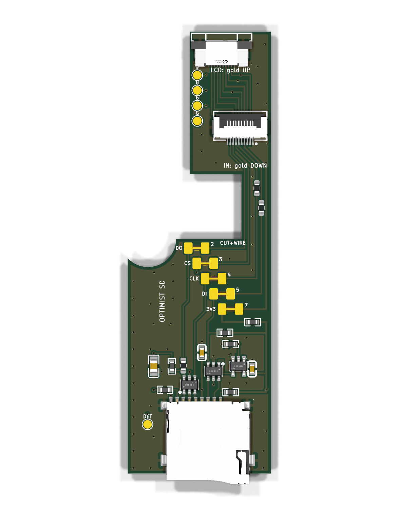

# The FM-1 SD board (v6)

> [!NOTE]
> ## This version (v6) is the one that has been built, tested and works
>
> v6 (the first order, 2026-10-28) ran an SD card in an FM-1 (the user, 2026-11-04). It is the **only tested version**.
> The two v7 variants next to it, [`../long-both-sides/`](../long-both-sides/) and
> [`../long-same-side/`](../long-same-side/), are **not built and not tested**: they only move the flat-cable
> socket J2 (and drop the swap jumpers and the J12 test pads). See "The versions" below. The bench tests under "Still
> open" are still the list to run on any new board.

## Minor update (2026-11-04), all three boards, same folders, no new version

- **R8, 47 kOhm 0603 (C25819, the pull-ups' own part): the card's CMD pull-up**, as m-card's R8 (Julius Vitkauskas, <https://github.com/jvitkauskas/m-card>, ec63784, CC0-1.0). Left pad on the card's DI net (J1 pin 3 and U2's DI line, behind the swap jumper JP4 and R6), right pad on the 3V3 rail at 95.9 mm across; R8 at 88.6 mm across, 23.4 mm up, nothing else moved. Card side: R8's net is the one behind R6 (510 Ohm), so the LCD bus (MOSI, in front of R6) sees it only through 510 Ohm: 70 uA at most.
- **Ground stitching vias**, `lib/stitch.py` (after m-card's `stitch()`): 31 more GND vias on a 1 mm grid, 3 mm apart and from the hand-placed ones, 0.25 mm clear of all copper, not in a part's box or under text, at least 1.5 mm from any CLK, MOSI, MISO or DAT0 copper (the bottom pour under those lines stays unbroken). The hand-placed vias stay.
- The order readme is now one file for the three boards, [`../README.md`](../README.md); this file keeps the design detail.

## The versions

| Folder | Status | J2 (the cable from J12) | Price, 15 boards assembled |
|---|---|---|---|
| `archive-v6-tested/` (v6, this one) | **built, tested, works** | top side, its own part (C2856798, bottom contact), 91.3 mm across, 58.5 up | 82.46 USD |
| `long-same-side/` | untested | top side, the same part as J3 (C3446068), in line with J3 (88.0 mm across), 58.5 up | 81.43 USD |
| `long-both-sides/` | untested | bottom side, the same part as J3, in line with J3, 58.5 up, contacts facing away from the board | 115.45 USD |

The v7 variants are v6 with the connectors moved: J2 is the same part as J3 and in line with it, and J3 is 0.6 mm
lower. Also gone, on the user's request: the five swap jumpers (each line is now plain copper, so a wrong J12 guess can
no longer be fixed by cutting a bridge) and the four J12 test pads (pins 6, 8 and 9 only run through). The nets are the
same (68 pins on the board, 68 in the schematic, DRC 0); the outline, the card socket, the ESD, the resistors and the
tray are v6's. Prices are JLCPCB's live quotes of 2026-11-04 (Standard assembly, before shipping
and VAT; 10 boards: 69.81, 68.52 and 102.54 USD). The bottom variant is dearer because both sides are assembled
(setup and stencil doubled, about 34 USD more whatever the quantity). This file and `../fm1/MEASUREMENTS.md` describe v6.

A board with everything the SD card mod needs (docs/SD-CARD-DESIGN.md), and the splitter too: a push-push microSD
socket, the chip-select inverter, the 220 Ohm on the card's data out, the pull-ups, the decoupling, and two 10-pin
0.5 mm flat-cable sockets (the user, 2026-10-25). It sits on the back of the FM-1's board, right of the battery, by
the battery's plug (the battery stays). Its lower part (25.4 x 41.5 mm, the card socket) slides into a printed tray
round the cover's pole there; a column goes up the right of the speaker plug to a head right under the audio jacks.
- **J3**, at the top, under the gap between the black jacks: the LCD's own cable plugs in here instead of into J12.
- **J2**, below it: a standard 10-pin cable from J12 (the FM-1's LCD socket), round the board's edge between the right
  black jack and the USB socket.
- All 10 lines go straight from J2 to J3 (the LCD works as before); the SD part takes the six it needs.

The card goes in through the case's bottom wall, flush with the outside, 81.7 mm from the left wall. **No soldering.**
Status (v6, 2026-10-27): **rerouted to J12's pin map as Julius probed it** (docs/SD-CARD-DESIGN.md section 3) and
checked (KiCad: no design-rule error, the schematic's nets equal the board's, 82 pins); sizes measured with calipers
(`../fm1/MEASUREMENTS.md`). **Ready to order as a prototype** (2026-10-28): J12's pin 7 and the cable's face are settled; the
bench tests under "Still open" come with the first boards.

**Done in v6** (the reviews of 2026-10-25, the user's rulings):
- J2 and J3 carry J12's probed order: 1 and 10 GND, 2 PC8 (D/C, the card's DO), 3 PC7 (LCD CS), 4 PC9 (CLK),
  5 PC10 (MOSI), 7 3.3 V; 6, 8 and 9 (not probed) only through.
- **J3 single-sided, top contact**: XUNPU FPC-0.5AS-10PWBH20, C3446068 (a slide lock), turned so its opening faces the
  top edge as before, 1.5 mm right of v5's (its body is wider), its opening 0.6 mm higher (76.4 mm up, the edge 76.7). Turned, its own pin numbers run right
  to left, so it is wired by place (`J3_AT` in `make_board.py`): the line on J2 pin n reaches J3's n-th contact from
  the left, as on v5.
- **R4 a pull-down** on the inverter's input (the card deselected while the FM-1 resets, as the firmware idles).
- **R1 = 220 Ohm** (C22962), and **R5, R6 = 510 Ohm** (C23193) in series on CLK and MOSI at the top of the column,
  where the SD branch leaves the through-lines (CLK_SD and MOSI_SD below them). Julius's prototype review
  (2026-10-28, the user's ruling): with a card in its native mode (a cold boot into stock, SLOOP or Felucca, which
  never put it in SPI mode) the stock screen went blank with CLK direct and 510 Ohm on DI, was distorted with 150 Ohm on
  CLK, and was fine with 510 on both. R1 at 220 bounds a card left in SPI mode driving DO against D/C (firmware that idles
  the LCD's CS high selects the card) to 15 mA, not 33; it costs timing margin with the spec's slowest card at 20 MHz
  (`docs/SD-CARD-DESIGN.md` section 4), where the auto clock steps down.
  **The three to retune on the bench** (Julius's values were found by trial on hand wiring, not calculated: "510 is a
  bit high but works"): R1, R5, R6 sit on 0603 **hand-solder pads** (longer, an iron reaches each end) so they can be
  swapped. If the screen misbehaves with a card in, go up (R5/R6 to 680-1k); if `sd bench` shows CRC errors at 20 MHz
  and the screen is fine, go down (R5/R6 to 330, R1 to 150 or 100). No trimmers: a pot on a 20 MHz clock line adds
  more trouble than it solves.
- **R7, 47 kOhm: DAT0 pulled up** at the card (the SD spec's 10-100 kOhm on DAT): an empty slot reads 0xFF without
  relying on PC8's internal pull-up.
- **The card's supply on its own**: 3V3 from JP5 goes through **FB1**, a ferrite bead (Sunlord GZ1608D601TF, 600 Ohm
  at 100 MHz, 0.45 Ohm, 200 mA, C1002), to SD_VDD; **C3, 100 nF**, sits on the card's VDD contact line between the ESD
  chips, beside C1's 10 uF. A hot-inserted card charges from C1, not from the LCD's rail. (JieLi's AC791N guide uses
  1 Ohm + 100 nF + 10 uF for TF cards; the bead sits in the same 0603 footprint.)
- **TP5 (DET)**: the socket's card switch (J1 pin 9) on a test pad left of the socket, through a via under the socket.
  The firmware does not use it.
- **The column**: lanes in J2's own order, MISO, LCD_CS, a **ground guard lane**, CLK, MOSI, 3V3 (MISO next to the
  quiet chip select, CLK's edges a ground lane away from it), the guard tied to the bottom pour by five vias; the
  bottom layer under the column is solid ground. LCD_CS crosses CLK and MOSI on the bottom (a via each end; it
  changes only at a card session's start and end). The column keeps its width: no room for stitching vias outside
  the lanes.
- **ESD at the card**: two **USBLC6-2SC6** (C7519, two lines each), every card line straight through one of their
  columns (pins 1 and 6 are one line, 3 and 4 the other: no stub): U3 on DAT0 and CLK (its GND pin over the card's
  ground contact), U2 on CMD and CS; VBUS on the card's 3.3 V. (The 4-line USBLC6-4SC6 cannot sit across these lines
  without stubs.)
- **The swap block** (Julius's idea, 2026-10-27): between J2 and the SD part, each line (DO, CS, CLK, DI, 3V3) runs
  through two pads joined by a thin copper bridge (KiCad's bridged solder jumper: copper only, nothing to assemble).
  If J12's pin map is wrong, **cut the bridge** and wire the right J12 line to the SD part's input: the right pad of
  each row is J12's side, the left pad the SD part's. Test pads in the head reach J12's unprobed pins 6, 8, 9 and
  GND (TP1-TP4, labelled 6, 8, 9, G), so any J12 line can feed any input. Solder the bridge back (or a blob) to
  undo a cut. The same pads probe every line.
- **Parts off the tray's lips**: U1, R2, R4, C2 moved left (U1's box ends 4.3 mm from the right edge); `make_board.py`
  now asserts a 2 mm keep-out on every part's box (the left edge the whole length, the right to the right post's top,
  24 mm).

**Still open (bench tests with the first boards; the mockup checks before ordering if the print is at hand):**
- **Must-pass bench test (Julius)**: stock and SLOOP, **cold boot with a card in** (the card stays in native mode the
  whole session): the screen must stay right. If it does not, raise R5 (and R6). Optimist puts the card in SPI mode
  before its first LCD command; other firmware does not.
- **Hot insertion**: insert a card while the FM-1 runs and watch the screen.
- Done: **J12 pin 7 = 3.3 V** (Julius, 2026-10-28): his working prototype powers the card from it.
- Done: **the mirror check** (2026-10-28, from `../fm1/MEASUREMENTS.md`): at J12 the cable's contacts face the FM-1 board, and
  round the board's edge they keep facing it, so at J2 they face our board (gold DOWN). With J12 counting from the
  right and J2's opening to the top edge, J12 pin 1 lands on J2's first contact from the left: no mirror with the type A
  cable. **J2 is now single-sided, bottom contact** (XUNPU FPC-05F-10PH20, C2856798, turned and wired by place as J3,
  `J2_AT`): a cable turned over does not connect.
- **J3's numbering by place** (`J3_AT`, reversed): check it against the LCD's flex on the printed mockup before
  ordering. Every LCD line depends on it.
- **J3 lower** (the LCD's bonded flex not under tension for life): not done; v6's opening is 0.6 mm higher than v5's.
  How low it may go is for the mockup (the LCD's cable only just reaches).
- **The cable is the weakest part of the path**: 80 mm, 10 lines at 0.5 mm, ground only on pins 1 and 10; MISO, CS,
  CLK, MOSI side by side in it (J12's order). Use the shortest cable that reaches. Four layers only if the bench shows
  CRC errors at 30 MHz (the auto clock stays the safety net).
- Compatibility (Julius): m-bootloader's SD stage uses the same pins and session (an LCD NOP, PC8 as input, SPI1 CON
  bit 3, CS through the PC7 inverter) and should work with this board unchanged.
- Owners: take the card out before a stock firmware update (a firmware that idles the LCD's CS high selects the card).

## The kit

1. **This board**, ordered assembled (below).
2. **A 10-pin 0.5 mm cable, type A** (contacts on the same face at both ends), 80 mm, from J12 to J2, gold facing the
   FM-1 board at J12 and our board at J2. The listing the user ordered from:
   https://www.aliexpress.com/item/4000022050815.html (10 pin, 0.5 mm pitch, type A).
3. **The tray** (`../tray/sd-tray.stl`, 3D print): the board slides in from the bottom end until it meets the collar.
4. **A slot in the bottom wall** for the card: about 15 x 2.5 mm, the card's left side 81.7 mm from the left wall's
   inside (the socket's 2 mm further left).

## Order it (JLCPCB, assembled)

1. jlcpcb.com > Order now > upload `fab/sd-board-gerbers.zip` (2 layers, 25.4 x 78.2 mm overall, 1.6 mm; the defaults are fine).
2. Tick **PCB Assembly**, top side, Economic.
3. Upload `fab/bom.csv` (the parts) and `fab/cpl.csv` (where they go). Every part is a JLC part (LCSC numbers in the BOM).
4. Check the placement preview: the card socket's opening past the bottom edge, both 10-pin sockets' openings facing the top,
   U1's pin 1 dot as on the render.
5. Order. JLC quote of 2026-10-25 (v5 files; v6 adds R5, R6, R7, C3 and FB1, basic parts, and J2 and J3 are other extended parts: quote again; Economic, 2-day PCB, before the ESD chip and the 33 ohm resistors):
   2 assembled of 5 bare 26.99 USD, 5: 28.99, 10: 33.31, 20: 42.86, 30: 49.81, 50: 65.56. About 19 USD of it is fixed per
   order (setup 8.24, stencil 1.55, three extended parts 9.27: card socket, 10-pin socket, inverter). The ESD chip adds one
   more extended part (about 3.50). Shipping to Belgium for 5 (0.29 kg): Global Standard 8.16 (12-16 days), EuroPacket
   15.08, DHL 23.40; VAT not shown in the quote.

The same board can be shared on OSHWLab (JLC's open-hardware site) so anyone orders it from a page: import the KiCad
project (`sd-board.kicad_pcb`, `sd-board.kicad_sch`) into EasyEDA Pro (File > Import > KiCad), publish it.

Check the fit first: `mockup-printable.stl` (3D print, one piece: the board and its parts as blocks), or
`template-1to1.pdf` (print at 100 %).

## The FFC socket's pins

As J12 (Julius, 2026-10-27): J12 pin n on J2's and J3's n-th contact from the left (both wired by place). **J12 counts from
the right**: pin 1 is the leg by the FM-1 board's dot, the right end with the connector's opening up
(`../fm1/j12-wiring-points.png`). The LCD's flex turns over on its way to J3 (its contacts face the FM-1 board at J12, up at
J3), so J12's right end lands on J3's left end: line 1 on J3's first contact from the left, as wired. The printed
mockup's check confirms it.

| J12 pin (contact from the left on J2, J3) | Line |
|---|---|
| 1, 10 | GND |
| 2 | MISO = the LCD's D/C (PC8) |
| 3 | LCD CS (PC7) |
| 4 | CLK (PC9) |
| 5 | MOSI (PC10) |
| 6 | not probed: only through |
| 7 | 3.3 V (confirmed: Julius's prototype runs the card from it) |
| 8, 9 | not probed (the LCD's reset and backlight?): only through |

## The design

| Ref | Part | LCSC |
|---|---|---|
| J1 | microSD socket, push-push (Korean Hroparts TF-01A) | C91145 |
| J2 | FPC socket, 10 pins, 0.5 mm, bottom contact only, right angle, 2 mm high (XUNPU FPC-05F-10PH20) | C2856798 |
| J3 | FPC socket, 10 pins, 0.5 mm, top contact only, right angle, slide lock (XUNPU FPC-0.5AS-10PWBH20) | C3446068 |
| U1 | 74LVC1G04 single inverter, SOT-23-5 (TI SN74LVC1G04DBVR) | C7827 |
| R1 | 220 Ohm 0603: the card's DO to the FM-1's PC8 (shared with the LCD's D/C) | C22962 |
| R5, R6 | 510 Ohm 0603: in series on CLK and MOSI where the SD branch leaves the through-lines | C23193 |
| R2, R3 | 47 kOhm 0603: DAT2, DAT1 pulled up (unused in SPI mode) | C25819 |
| R7 | 47 kOhm 0603: DAT0 pulled up at the card | C25819 |
| R8 | 47 kOhm 0603: CMD (DI) pulled up at the card, behind R6 (minor update, 2026-11-04) | C25819 |
| FB1 | ferrite bead 0603, 600 Ohm at 100 MHz, 200 mA (Sunlord GZ1608D601TF): 3V3 to the card's supply | C1002 |
| R4 | 47 kOhm 0603: the inverter's input pulled DOWN while the FM-1 resets (the card deselected) | C25819 |
| U2, U3 | USBLC6-2SC6, ESD for two lines each (flow-through), SOT-23-6 | C7519 |
| JP1-JP5 | the swap block: 1.5 x 2 mm pads 3 mm apart, a 1.5 mm bare copper bridge to cut (copper only, not in the BOM) | - |
| TP1-TP4 | test pads, 1.5 mm: J12's pins 6, 8, 9 and GND (copper only, not in the BOM) | - |
| TP5 | test pad, 1.5 mm: the socket's card switch (J1 pin 9, DET) | - |
| C1 | 10 uF 0805 | C15850 |
| C2 | 100 nF 0603 at U1 | C14663 |
| C3 | 100 nF 0603 at the card's VDD contact | C14663 |

The schematic: `sd-board-schematic.pdf` (and `sd-board.kicad_sch`, KiCad's own symbols, a net label on every pin).

Regenerate everything with `sh make_fab.sh` (KiCad 10): `make_board.py` builds the board from code (parts, nets, the
copper, the ground pours), `make_schematic.py` the schematic; `make_fab.sh` runs the design-rule check (board) and the
electrical rule check (schematic), checks that both have the same nets pin for pin (`check_nets.py`), and writes `fab/`.
The footprints in `lib/` are LCSC's own (EasyEDA's library, converted with easyeda2kicad), so they are the ones JLC
assembles on; the card socket's 3D model is moved 5.09 mm to sit on its pads. The DRC's remaining notes are silkscreen
only.
