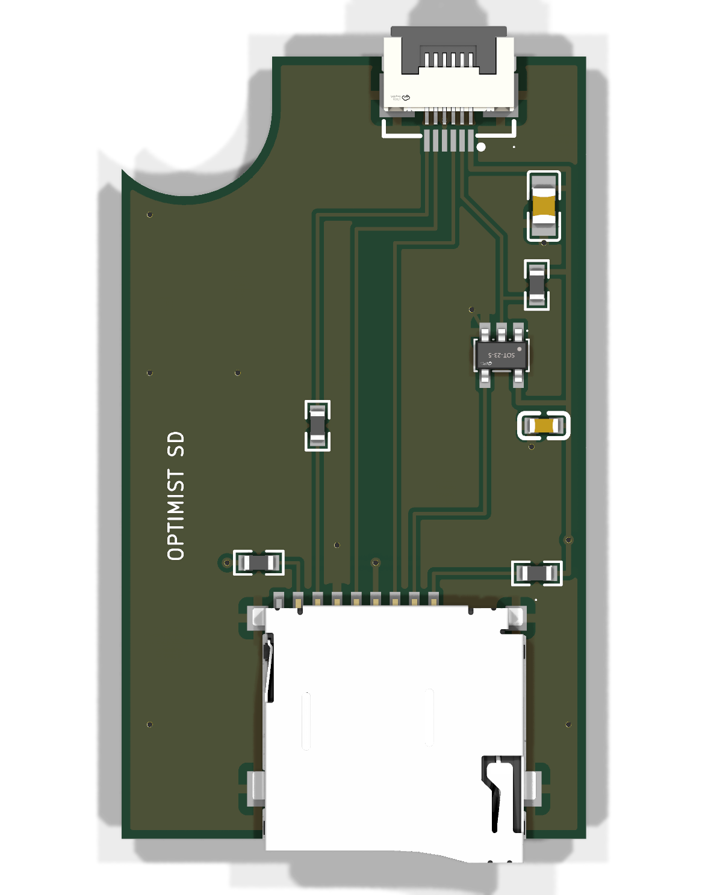

# The FM-1 SD board (v5)

A board with everything the SD card mod needs (docs/SD-CARD-DESIGN.md), and the splitter too: a push-push microSD
socket, the chip-select inverter, the 220 Ohm on the card's data out, the pull-ups, the decoupling, and two 10-pin
0.5 mm flat-cable sockets (the user, 2026-10-25). It sits on the back of the FM-1's board, right of the battery, by
the battery's plug (the battery stays). Its lower part (25.4 x 41.5 mm, the card socket) slides into a printed tray
round the cover's pole there; a column goes up the right of the speaker plug to a head right under the audio jacks.
- **J3**, at the top, under the gap between the black jacks: the LCD's own cable plugs in here instead of into J12.
- **J2**, below it: a standard 10-pin cable from J12 (the FM-1's LCD socket), round the board's edge between the right
  black jack and the USB socket.
- All 10 lines go straight from J2 to J3 (the LCD works as before); the SD part takes the six it needs.

The card goes in through the case's bottom wall, flush with the outside, 81.7 mm from the left wall. **No soldering.**
Status (2026-10-25): designed and checked (KiCad: no design-rule error, the schematic's nets equal the board's); sizes
measured with calipers (`MEASUREMENTS.md`); **NOT READY TO ORDER: the board is routed to a PROVISIONAL J12 guess**
(`LCD_PINS` in `make_board.py`) that Julius's probing (2026-10-27) contradicts from pin 3 on (table below), and
whether the LCD cable arrives mirrored is still to check (the breakout). Then the lines are re-routed, with the list
under "Before ordering".

**Before ordering** (the reviews of 2026-10-25, the user's rulings), with the re-route once J12's pin map is known:
- **Single-sided sockets** (the user): a cable turned over must not connect, not connect mirrored (with the provisional
  map a flipped cable puts the backlight's LEDA on CLK, 3V3 on the LCD's CS, RST on MOSI). J3 = top-contact (the LCD's
  own cable arrives gold up, checked); J2's face is what the breakout's mirror check answers, picked then. The
  double-sided HCTL part goes. Parts found (2026-10-26, LCSC; footprints in `lib/`): **J3 = XUNPU
  FPC-0.5AS-10PWBH20, C3446068**: 10P 0.5 mm, top contact only, right angle, SMT, a slide lock (no top-contact flip
  lock in stock); **J2 if bottom contact = XUNPU FPC-05F-10PH20, C2856798** (bottom contact, flip lock); a top-contact
  J2 would be C3446068 too.
- **On the breakout, before routing** (the pin finder's session): every pin's line; LEDA's voltage; and the 3.3 V's
  headroom: 33 Ohm (100 mA) from J12's 3V3 to GND with the FM-1 running, the rail and the screen watched. If it sags,
  a Y-tap on the battery plug (right beside the board) into an LDO on the board feeds the card instead.
- **100 Ohm** 0603 in series on CLK and MOSI where the SD branch leaves the through-lines (not 33: the branch is the
  whole ~55 mm column, and 100 Ohm also bounds a native-mode card answering on CMD against PC10 to ~15 mA).
- **R4 a pull-DOWN** (the inverter's input): the firmware now idles with the LCD's CS low (the card deselected,
  `hal/fm1_lcd_hw.h` FM1_LCD_IDLE_CS), so the card is also deselected while the FM-1 resets.
- **R1 = 100 Ohm** for the order (47 Ohm on the shelf): 220 Ohm likely misses 20 MHz (SD-CARD-DESIGN.md section 4,
  the timing); `sd bench`'s 20 MHz rows decide. With the card deselected at idle, the only D/C overlap left is inside
  a deselect, under half a microsecond (22 mA at 100 Ohm, 34 mA at 47).
- **J3 a few mm lower** if the head allows: the LCD's bonded flex should not sit under tension for life.
- ESD protection at the card socket: **one** USBLC6-2SC6 (C7519, SOT-23-6, footprint in `lib/`): its four I/O lines
  are exactly CLK, CMD, CS and DAT0, its VBUS pin on 3V3, GND on the pour (the slot is open to the outside).
- R1 and the CLK / MOSI series resistors: 100 Ohm 0603, C22775 (JLC basic).
- **The column** (the user, 2026-10-25 review; `make_board.py` LANE / UP / COL_L, the via list): today five lanes side
  by side for ~35 mm at 0.65 mm pitch, MISO next to CLK (the worst pairing: CLK's edge couples into MISO when the chip
  samples it), no pour between the lanes, one stitching via near the top. Re-route:
  1. lane order **CLK, MOSI, 3V3, LCD_CS, MISO** (the quiet lines between the aggressors and the victim);
  2. the column wider (MEASUREMENTS E: free to 101 mm right of the speaker plug; it uses 91.5-96.8 today), with a
     **ground trace between the CLK / MOSI pair and the quiet group**, tied to the bottom pour by vias;
  3. **stitching vias along both sides of the column every ~5 mm** (both pours), and one each side at the top and the
     bottom of the lane run;
  4. kept as they are: R1 at the card's end of DAT0, the 100 Ohm CLK / MOSI resistors at the J2 end of the branch,
     the J3-J2 pass-through short and over the pour;
  5. four layers only if the bench still shows CRC errors at 30 MHz after this (the auto clock stays the safety net).
- **Parts off the tray's lips** (the user, 2026-10-25 review): U1, R2, R4, C2 sit 2.4-3.2 mm from the right edge
  (copper ~1.4 mm), right where the tray's right lip (0.8 mm over the edge, up to RIGHT_END 24 mm) passes as the board
  slides in. Move them above the card socket (v > ~16), at least 2 mm from the right edge, with the 3V3 rail (RAIL
  95.8 today); and `make_board.py` asserts a 2 mm keep-out from each edge where a lip runs (the left the whole length,
  the right to RIGHT_END), checked on every placed part's courtyard. The left side is fine already.
- **The cable is the weakest part of the path**: 80 mm, 10 lines at 0.5 mm, ground only on pins 1 and 10, the order
  fixed by J12 (the provisional map has MISO, CLK, MOSI side by side). The path is only as good as the cable: use the
  shortest cable that reaches.
- Owners: take the card out before a stock firmware update (a firmware that idles the LCD's CS high selects the card).

## The kit

1. **This board**, ordered assembled (below).
2. **A 10-pin 0.5 mm cable**, 60 or 80 mm (the user has both types, A and B: the sockets take either), from J12 to J2.
   The listing the user ordered from: https://www.aliexpress.com/item/4000022050815.html (pick 10 pin, 0.5 mm pitch,
   the length; the type, A or B, follows J2's contact face, picked after the breakout's mirror check).
3. **The tray** (`sd-tray.stl`, 3D print): the board slides in from the bottom end until it meets the collar.
4. **A slot in the bottom wall** for the card: about 15 x 2.5 mm, the card's left side 81.7 mm from the left wall's
   inside (the socket's 2 mm further left).

## Order it (JLCPCB, assembled)

1. jlcpcb.com > Order now > upload `fab/sd-board-gerbers.zip` (2 layers, 25.4 x 78.2 mm overall, 1.6 mm; the defaults are fine).
2. Tick **PCB Assembly**, top side, Economic.
3. Upload `fab/bom.csv` (the parts) and `fab/cpl.csv` (where they go). Every part is a JLC part (LCSC numbers in the BOM).
4. Check the placement preview: the card socket's opening past the bottom edge, both 10-pin sockets' openings facing the top,
   U1's pin 1 dot as on the render.
3b. JLC warns "multiple lines matched to the same part" on J2/J3 (same socket, two values): correct, tick both.
5. Order. JLC quote of 2026-10-25 (v5 files, Economic, 2-day PCB, before the ESD chip and the 33 ohm resistors):
   2 assembled of 5 bare 26.99 USD, 5: 28.99, 10: 33.31, 20: 42.86, 30: 49.81, 50: 65.56. About 19 USD of it is fixed per
   order (setup 8.24, stencil 1.55, three extended parts 9.27: card socket, 10-pin socket, inverter). The ESD chip adds one
   more extended part (about 3.50). Shipping to Belgium for 5 (0.29 kg): Global Standard 8.16 (12-16 days), EuroPacket
   15.08, DHL 23.40; VAT not shown in the quote.

The same board can be shared on OSHWLab (JLC's open-hardware site) so anyone orders it from a page: import the KiCad
project (`sd-board.kicad_pcb`, `sd-board.kicad_sch`) into EasyEDA Pro (File > Import > KiCad), publish it.

Check the fit first: `mockup-printable.stl` (3D print, one piece: the board and its parts as blocks), or
`template-1to1.pdf` (print at 100 %).

## The FFC socket's pins

The board is still routed to the provisional guess. J12 as probed (Julius, 2026-10-27, docs/SD-CARD-DESIGN.md
section 3) differs from pin 3 on, so the board must be re-routed before ordering.

| J2 / J3 pin | Routed today (PROVISIONAL guess) | J12 as probed |
|---|---|---|
| 1, 10 | GND | GND |
| 2 | MISO = the LCD's D/C (PC8) | PC8, D/C |
| 3 | CLK (PC9) | PC7, LCD CS |
| 4 | MOSI (PC10) | PC9, CLK |
| 5 | LCD CS (PC7) | PC10, MOSI |
| 6 | 3.3 V | not probed |
| 7 | through | 3.3 V (to confirm: beep to U2 pin 16 / chip pin 28) |
| 8, 9 | the LCD's reset and backlight: only through | not probed |

## The design

| Ref | Part | LCSC |
|---|---|---|
| J1 | microSD socket, push-push (Korean Hroparts TF-01A) | C91145 |
| J2, J3 | FPC socket, 10 pins, 0.5 mm, contacts on both sides, flip lock, 1 mm high (HCTL HC-FPC-05-09-10RLTAG; JLCPCB stock, SMT assembly) | C5213750 |
| U1 | 74LVC1G04 single inverter, SOT-23-5 (TI SN74LVC1G04DBVR) | C7827 |
| R1 | 220 Ohm 0603: the card's DO to the FM-1's PC8 (shared with the LCD's D/C) | C22962 |
| R2, R3 | 47 kOhm 0603: DAT2, DAT1 pulled up (unused in SPI mode) | C25819 |
| R4 | 47 kOhm 0603: the inverter's input held while the FM-1 resets. It also sets the idle polarity: pulled UP today (the card selected); to become a pull-DOWN with the next re-route (the card deselected, as the firmware now idles: Before ordering) | C25819 |
| C1 | 10 uF 0805 | C15850 |
| C2 | 100 nF 0603 at U1 | C14663 |

The schematic: `sd-board-schematic.pdf` (and `sd-board.kicad_sch`, KiCad's own symbols, a net label on every pin).

Regenerate everything with `sh make_fab.sh` (KiCad 10): `make_board.py` builds the board from code (parts, nets, the
copper, the ground pours), `make_schematic.py` the schematic; `make_fab.sh` runs the design-rule check (board) and the
electrical rule check (schematic), checks that both have the same nets pin for pin (`check_nets.py`), and writes `fab/`.
The footprints in `lib/` are LCSC's own (EasyEDA's library, converted with easyeda2kicad), so they are the ones JLC
assembles on; the card socket's 3D model is moved 5.09 mm to sit on its pads. The DRC's remaining notes are silkscreen
only.
